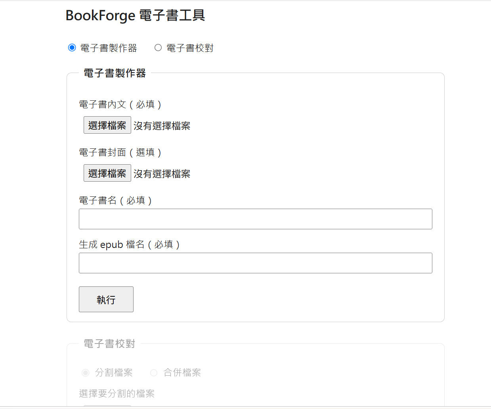

# BookForge

**BookForge** is a config-driven EPUB authoring pipeline that turns a single Word/ODT/Markdown/plain-text manuscript into a polished `.epub` file — either a single-article EPUB or a full multi-chapter book with an auto-generated table of contents and cover. It also ships a small Flask web UI so the whole workflow (including a docx split/merge proofreading helper and a Traditional/Simplified Chinese converter) can be run without touching the command line.

> 這是一套以 config 設定檔驅動的 EPUB 製作工具，可以把一份 Word / ODT / Markdown / 純文字手稿，轉成排版完整的 `.epub` 電子書——不管是單篇文章，還是需要自動產生目錄、封面的多章節書籍都支援。專案裡也附了一個簡單的 Flask 網頁介面，讓你不用打指令就能操作整套流程（包含一個給人工校對用的 docx 分割／合併小工具，以及簡繁體轉換小工具）。

---

## Screenshot



> 上面是網頁介面的截圖，實際檔案放在 `sample/sample.png`。

---

## Features

- **Two output modes, auto-detected**: a manuscript with no `Heading 1` styles is packaged as a minimal single-page EPUB (no TOC); a manuscript with multiple `Heading 1` sections is automatically packaged as a full book — auto-generated TOC, multi-chapter spine, and optional cover — with zero manual mode switching.
- **Faithful image handling for `.docx` sources**: inline images are parsed in their original run order (fixing a common bug where text sharing a paragraph with an image gets silently dropped), and each image's on-page display width is calculated from the manuscript's actual page layout, so a full-page image or a half-page image in Word keeps roughly the same visual proportion in the EPUB — instead of always rendering at native pixel size.
- **Configurable chapter title extraction**: chapter titles used in the table of contents can be the full heading text, everything before a chosen split character (useful for headings like "乾卦第一　乾上乾下" → "乾卦"), or the first N characters — controlled entirely from `config.py`, no code changes needed.
- **Text cleanup pipeline**: optional half-width → full-width punctuation conversion, with a numeric-safe mode so things like `3.14` or `1,000` aren't mangled. An optional OpenCC Traditional/Simplified conversion step can also be switched on (`convert_chinese_enable`, off by default).
- **Image processing pipeline**: optional format conversion, JPEG quality control, max-side resizing, sRGB correction, HEIC conversion, and EXIF auto-rotation — applied consistently to embedded images, folder images, and the cover.
- **Front & back matter generation**: optional auto-generated title page, copyright page (edition number, localized date), and about-the-author page — each independently toggleable, placed correctly in reading order (cover → title page → copyright page → chapters → author bio), and excluded from the table of contents. All page wording (page titles, disclaimer, edition/copyright lines, fallback chapter titles) comes from per-language templates in `LANGUAGE_PROFILES`. All user-supplied text is HTML-escaped before being embedded, so stray `&`/`<`/`>` characters in a title or bio can't produce an invalid EPUB.
- **Per-language page templates (currently zh-TW and zh-CN)**: the web UI's language dropdown is generated from `LANGUAGE_PROFILES` in `config.py`. The selected language sets the EPUB language metadata, every page's `lang` attribute, all front/back-matter wording, and the copyright-page date format; the choice applies to that one request and never rewrites `config.py`. Adding a language starts with one new entry in `LANGUAGE_PROFILES`. **Not yet language-aware:** typography in `raw.css` and the punctuation rules in `text_cleaner.py` (see Known Limitations and the multi-language plan in `多語系擴充架構規劃.md`).
- **A small Flask web app** (`app.py`) with three panels:
  - **eBook Builder** — pick a book language, upload a manuscript (+ optional cover), set a book title and output filename, optionally fill in front/back matter fields, and produce a finished `.epub` on your desktop.
  - **Proofreading helper** — split a `.docx` into per-chapter files (by Heading 1 or Heading 2) for manual proofreading (e.g. pasting into an AI chat), then merge the proofread files back into one `.docx`.
  - **Chinese variant converter** — upload a `.docx`/`.txt`/`.md` file and convert it between Traditional and Simplified Chinese with OpenCC (`t2s` / `s2t` / `t2tw`). For `.docx`, text is converted run by run so inline images and bold/italic formatting survive.
- **Multiple source formats**: `.docx` has full support (see Known Limitations for the other three).
- **EPUBCheck-clean output**: validated against real-world distributor requirements (Apple Books, B&N, Kobo, OverDrive, etc. via Draft2Digital) — notably avoids the CSS `:has()` selector, which EPUBCheck's CSS validator rejects outright even though it renders fine in modern browsers/readers.

> 主要功能：（1）自動判斷單篇文章或多章節書籍，不用手動切換模式；（2）針對 docx 圖片做了保序解析跟顯示比例還原，讓整頁大圖或局部圖片在電子書裡維持接近原稿的視覺比例；（3）章節標題擷取規則（完整標題／依字元截斷／取前 N 字）完全由 config 控制；（4）文字標點符號全半形轉換、圖片格式/畫質/尺寸處理都是可開關的管道，另有一個預設關閉的 OpenCC 簡繁轉換步驟；（5）選填的書名頁／版權頁／作者介紹頁，各自獨立開關、排序正確、不會出現在目錄裡，頁面上的所有文字（頁面標題、免責聲明、刷次與版權行、備用章節標題）都來自 `LANGUAGE_PROFILES` 的語言範本，使用者輸入的文字都會做 HTML 跳脫處理；（6）網頁介面的語言下拉選單由 `LANGUAGE_PROFILES` 自動產生，目前支援繁體中文（zh-TW）與簡體中文（zh-CN），選擇只影響該次請求，不會改寫 `config.py`；選語言會影響 EPUB 語言標籤、各頁 `lang` 屬性、前後文頁面文字與日期格式，但**還不會**影響排版（`raw.css`）與標點規則（`text_cleaner.py`）；（7）附一個 Flask 網頁介面，包含「電子書製作器」、給人工校對用的「分割／合併」小工具，以及「簡繁互換」小工具（docx 逐 run 轉換，圖片與粗斜體會保留）；（8）輸出的 EPUB 已經過 EPUBCheck 驗證可以正常上架。目前只有 `.docx` 是完整支援，其餘三種格式的限制請見下方「Known Limitations」。

---

## Project Structure

```
BookForge/
├── app.py                  # Flask web app entry point
├── main.py                 # CLI entry point + shared run_pipeline() core
├── config.py                # All tunable settings live here (incl. LANGUAGE_PROFILES)
├── output_utils.py          # Output folder / filename helpers (web app output folder is hardcoded here)
├── separate.py               # Splits a .docx into per-chapter files
├── combine.py                # Merges per-chapter .docx files back into one
├── requirements.txt
├── LICENSE
├── README.md
├── 多語系擴充架構規劃.md      # Multi-language expansion plan + progress log
├── sample/
│   └── sample.png            # Screenshot used above
├── templates/                # Flask HTML templates (web UI)
│   └── index.html
├── epub_templates/           # EPUB layout templates + CSS (unrelated to templates/ above)
│   ├── __init__.py
│   ├── template_engine.py    # Auto image layout logic for the single-article templates below
│   ├── raw.css                # Used for the book path (multi-chapter)
│   ├── minimal.css            # Single-article template: no images
│   ├── quote.css               # Single-article template: 1 image
│   ├── interleaved.css         # Single-article template: 2–3 images
│   └── rich.css                 # Single-article template: 4+ images
├── parsers/
│   ├── __init__.py           # Dispatches by file extension
│   ├── docx_parser.py        # Full support
│   ├── odt_parser.py         # Partial support
│   ├── md_parser.py          # Partial support
│   └── txt_parser.py         # Partial support
├── builder/
│   ├── __init__.py
│   └── epub_builder.py       # Assembles the final .epub (page wording comes from LANGUAGE_PROFILES)
└── utils/
    ├── __init__.py
    ├── text_cleaner.py       # Punctuation conversion + optional OpenCC variant conversion
    └── image_processor.py
```

> 這是目前整個專案預期的資料夾結構。`templates/`（Flask 網頁樣板）跟 `epub_templates/`（EPUB 排版樣式）是兩個完全不同用途、刻意分開命名的資料夾，不要搞混。`epub_templates/` 裡的四個版型 CSS（`minimal`/`quote`/`interleaved`/`rich`）跟 `template_engine.py` 是單篇文章路徑專用的自動圖片排版邏輯，依圖片數量自動選版型；書籍路徑（多章節）一律走 `raw.css`，不會用到這四個檔案。目前都是能動的功能，予以保留，不因為近期主要在做書籍轉檔就刪除。`多語系擴充架構規劃.md` 是多語言擴充的規劃與進度紀錄，開新對話時請連同本 README 一起提供。

---

## Requirements

- Python 3.10+
- See `requirements.txt`: Flask, python-docx, markdown, beautifulsoup4, lxml, ebooklib, Pillow, pillow-heif, and `opencc-python-reimplemented` (the pip package name differs from the module name — the code does `from opencc import OpenCC`). OpenCC is imported at the top of `utils/text_cleaner.py`, so it is required even when the Traditional/Simplified conversion switch is off.

> 需要 Python 3.10 以上版本，套件清單都寫在 `requirements.txt` 裡。注意 OpenCC 的 pip 套件名稱是 `opencc-python-reimplemented`，程式裡的匯入名稱卻是 `opencc`；`text_cleaner.py` 一開頭就匯入它，所以即使簡繁轉換開關是關閉的，沒裝也會直接報錯。

---

## Installation

```bash
git clone <your-repo-url>
cd BookForge
python -m venv venv
venv\Scripts\activate        # Windows
# source venv/bin/activate   # macOS/Linux
pip install -r requirements.txt
```

> 標準的 clone → 建虛擬環境 → 安裝套件流程，Windows 跟 macOS/Linux 的啟用指令不同，照你的系統選一行執行。

---

## Usage

### Web app (recommended)

```bash
python app.py
```

Then open `http://127.0.0.1:5000` in your browser. Use the **eBook Builder** panel to upload a manuscript and produce an `.epub`, the **Proofreading** panel to split/merge `.docx` chapter files, or the **Chinese variant converter** panel for Traditional/Simplified conversion. EPUB files are written to `~/Desktop/電子書output/` — this folder is hardcoded as `OUTPUT_DIR` in `output_utils.py`, not read from `config.py`. Proofreading files go to `PROOFREAD_DIR` and converted files go to `cc_output_dir`, both set in `config.py`.

> 執行 `python app.py` 後，用瀏覽器打開網址即可操作。「電子書製作器」面板用來上傳手稿產出 EPUB，「電子書校對」面板用來分割/合併 docx 章節檔，「簡繁互換」面板用來轉換繁簡體。EPUB 的輸出資料夾（桌面的「電子書output」）是寫死在 `output_utils.py` 的 `OUTPUT_DIR`，**不是**從 `config.py` 讀的；校對檔案的資料夾是 `config.py` 的 `PROOFREAD_DIR`，簡繁轉換的輸出資料夾是 `cc_output_dir`。

### Command line

```bash
python main.py -i <input_folder> -o <output_file.epub>
```

The input folder should contain exactly one manuscript file (`.docx`/`.odt`/`.md`/`.txt`) plus, optionally, loose image files to be laid out alongside the text. Run `python main.py --help` for the full list of override flags (image processing toggles, text-cleanup toggles, `--book_title`, `--cover`). The CLI has no flag for book language or front/back-matter fields — set `BOOK_LANGUAGE` and the `enable_*` / `book_*` / `copyright_*` keys in `config.py` instead (see Known Limitations).

> CLI 模式的輸入資料夾裡只能放一份手稿檔案，可以額外放獨立的圖片檔案一起排版。`python main.py --help` 可以看到所有可用的命令列參數（圖片處理開關、文字清洗開關、`--book_title`、`--cover` 等）。CLI 沒有書籍語言與前後置頁面欄位的參數，需要時請直接改 `config.py`，細節見「Known Limitations」。

---

## Configuration (`config.py`)

All behavior is controlled from a single `CONFIG` dictionary — no need to touch parser/builder code for routine adjustments:

| Key | Purpose |
|---|---|
| `IMAGE_PROCESSING_ENABLE`, `IMAGE_OUTPUT_FORMAT`, `IMAGE_JPEG_QUALITY`, `IMAGE_RESIZE_ENABLE`, `IMAGE_MAX_SIDE`, `IMAGE_CONVERT_SRGB`, `IMAGE_HEIC_CONVERT`, `IMAGE_AUTO_ROTATE` | Image processing pipeline toggles/parameters |
| `TEXT_PUNCTUATION_CONVERT` and related `TEXT_CONVERT_*` keys | Half-width → full-width punctuation conversion rules (global, not per language) |
| `convert_chinese_enable`, `convert_chinese_mode` | Optional OpenCC conversion applied to body text by `utils/text_cleaner.py` (`clean_text()`), off by default; applies to every language when on. `convert_chinese_mode` (`t2s` / `s2t` / `t2tw`) is also the default mode of the Chinese variant converter panel |
| `CHAPTER_TITLE_EXTRACT_MODE` (`FULL` / `BEFORE_SPLIT_CHAR` / `FIRST_N_CHARS`), `CHAPTER_TITLE_SPLIT_CHAR`, `CHAPTER_TITLE_MAX_LENGTH` | How chapter titles are derived from `Heading 1` text for the table of contents |
| `CHAPTER_SPLIT_BY_H1` | Reserved for a future `separate.py` config-driven mode; not currently read by any code |
| `DEFAULT_INPUT_DIR`, `DEFAULT_OUTPUT_DIR`, `DEFAULT_OUTPUT_FILENAME` | Default paths for the CLI only (the web app's output folder is hardcoded in `output_utils.py`) |
| `PROOFREAD_DIR`, `cc_output_dir` | Folders used by the proofreading helper and the Chinese variant converter panel |
| `BOOK_LANGUAGE` | Default book language code; must be a key of `LANGUAGE_PROFILES`. The web UI overrides it per request |
| `LANGUAGE_PROFILES` | One entry per language: display name, front/back-matter wording and format strings, date format, fallback titles/text. Drives the web UI dropdown, the backend language whitelist, and `builder/epub_builder.py` |
| `enable_title_page`, `book_author`, `book_publisher`, `book_publish_year` | Title page settings (`book_author` is shared with the copyright page) |
| `enable_copyright_page`, `copyright_holder`, `copyright_publish_date`, `copyright_edition_number` | Copyright page settings |
| `enable_author_page`, `author_bio_text` | About-the-author page settings |

> `config.py` 是整個專案唯一的設定入口，日常調整幾乎都不用碰程式邏輯。表格列出目前所有的設定 key 跟用途，其中 `CHAPTER_SPLIT_BY_H1` 目前是保留欄位，還沒有任何程式碼讀取它。`LANGUAGE_PROFILES` 是多語言的核心：下拉選單、後端語系白名單、前後文頁面的所有文字都從這裡來，新增語言先在這裡加一筆。`convert_chinese_enable` 由 `text_cleaner.py` 的 `clean_text()` 讀取，預設關閉，開啟後不分語系都會轉換內文。網頁版的 EPUB 輸出資料夾不在 `config.py`，而是 `output_utils.py` 的 `OUTPUT_DIR`。

---

## Known Limitations

- **`.docx` is the only fully-supported format.** `.odt` only ever produces a single chapter (no chapter splitting, no image-width-ratio calculation). `.md` and `.txt` are also always single-chapter, with no heading hierarchy beyond a single title line.
- **No table-based layout support.** Content inside Word tables is not read at all — if a manuscript uses a table to lay out an image next to a caption, that entire table is silently skipped.
- **Text-wrapped ("floating") images are not reliably supported.** Only inline images (anchored directly in the text flow) parse correctly with guaranteed order; floating/anchored images may parse out of their intended visual position.
- **Single page-layout assumption.** Image display-width calculation assumes the whole document uses one consistent page/margin setup; a manuscript that switches page orientation or margins mid-document will produce inaccurate image sizing for the affected sections.
- **The split/merge proofreading tool only supports `.docx`.** Files of any other extension in the proofreading folder will abort the merge with an error rather than being processed.
- **Only zh-TW and zh-CN have language profiles.** The language choice changes metadata, page wording and date format only. Typography (`raw.css`, e.g. the Chinese first-line indent) and punctuation conversion are not language-aware yet, so a non-Chinese manuscript would still get Chinese typography and full-width punctuation. The `docx_parser.py` fallback chapter title has not been checked against the profiles.
- **Quote conversion is not language-aware.** `TEXT_CONVERT_QUOTES` turns straight `"…"` into `「…」`, which is the Traditional Chinese convention; Simplified Chinese normally uses `“…”`. It only affects straight quotes, so manuscripts that already contain curly quotes (typical for Word/LibreOffice auto-correct) are not touched.
- **The CLI cannot set language or front/back matter.** With the default `config.py`, `enable_title_page` and `enable_copyright_page` are on while `book_author`, `copyright_holder` and `copyright_publish_date` are empty, so a multi-chapter book built from the command line gets title/copyright pages with blank fields unless you fill those keys in `config.py` or switch the pages off. Single-article output ignores these pages anyway.
- **Cover page may be followed by a near-blank page on some readers at narrow/small screen sizes.** This is a known, accepted limitation, not a bug in the stylesheet: it traces back to the well-documented "100vh lies on mobile" CSS quirk (the viewport-height unit can report more space than is actually visible once a reader's own UI chrome is accounted for), and the usual modern fixes (`svh`/`dvh` units, the `:has()` selector) are not usable here because EPUBCheck's CSS validator — required to pass for Apple Books/B&N/Kobo/OverDrive distribution — rejects them as parse errors. `raw.css` uses a `96vh` safety margin as a partial mitigation; a worse-but-safe value can be tuned further if needed, but a small residual risk on some readers is accepted rather than invested in further.

> 目前只有 `.docx` 是完整支援的格式；`.odt`/`.md`/`.txt` 都只能產出單一章節，功能明顯陽春。完全不支援 Word 表格排版（表格內容會被整段忽略，不是排錯是直接消失），文繞圖也無法保證正確順序。圖片比例計算假設全文只有一種版面設定。分割/合併校對工具目前只吃 `.docx`。目前只有 zh-TW 與 zh-CN 有語言 Profile，選語言只影響語言標籤、前後文頁面文字與日期格式；排版（`raw.css` 的中文首行縮排等）跟標點轉換都還不分語言，所以非中文手稿仍會套用中文排版與全形標點，`docx_parser.py` 的備用章節標題也還沒對照過 Profile。引號轉換固定輸出 `「…」`，簡體慣例是 `“…”`，但它只處理半形直引號，Word／LibreOffice 自動校正過的彎引號不會被動到。CLI 沒有語言與前後置頁面的參數：預設 `config.py` 啟用書名頁與版權頁，但作者、版權所有人、出版日期都是空字串，用 CLI 轉多章節書籍時這些頁面會有空白欄位，需要自己填 `config.py` 或關掉開關。封面在部分閱讀器的小螢幕模式下，後面可能會多出一頁幾乎空白的頁面——這是已知且接受的限制，根源是行動裝置上知名的「100vh 計算偏差」問題，而業界標準解法（`svh`/`dvh` 單位、`:has()` 選擇器）這裡都用不了，因為 EPUBCheck（上架 Apple/B&N/Kobo/OverDrive 必須通過的驗證工具）會直接判定這些較新的 CSS 語法錯誤。目前用 `96vh` 留一點安全邊界做部分緩解，數值還可以再調整，但已經決定不再為了這個小問題繼續投入。

---

## Roadmap

- Multi-language expansion, one language per stage — stage 1 (Simplified Chinese page templates) is code-complete and awaiting real-book testing; next up is a Latin-script language (English), which needs per-language punctuation rules and CSS typography. See `多語系擴充架構規劃.md` for the plan and progress log.
- Table-based layout support (read `doc.tables`, not just `doc.paragraphs`)
- `.odt` chapter-splitting + image-ratio support (likely via a LibreOffice headless docx round-trip rather than hand-rolled ODF writing)

> 未來可能的擴充方向：多語言擴充（一種語言為一個階段，階段一的簡體中文頁面範本程式已完成、等待實際產書測試，下一個預計是拉丁字母語系的英文，需要先處理分語言的標點規則與 CSS 排版，規劃與進度見 `多語系擴充架構規劃.md`）、支援表格排版、補齊 `.odt` 的章節切分跟圖片比例功能（規劃走 LibreOffice headless 轉檔的路線）。

---

## License

Released under the MIT License — see `LICENSE`. You're welcome to use, modify, and redistribute this project.

> 採用 MIT 授權（詳見 `LICENSE`），歡迎自由引用、修改、轉發。